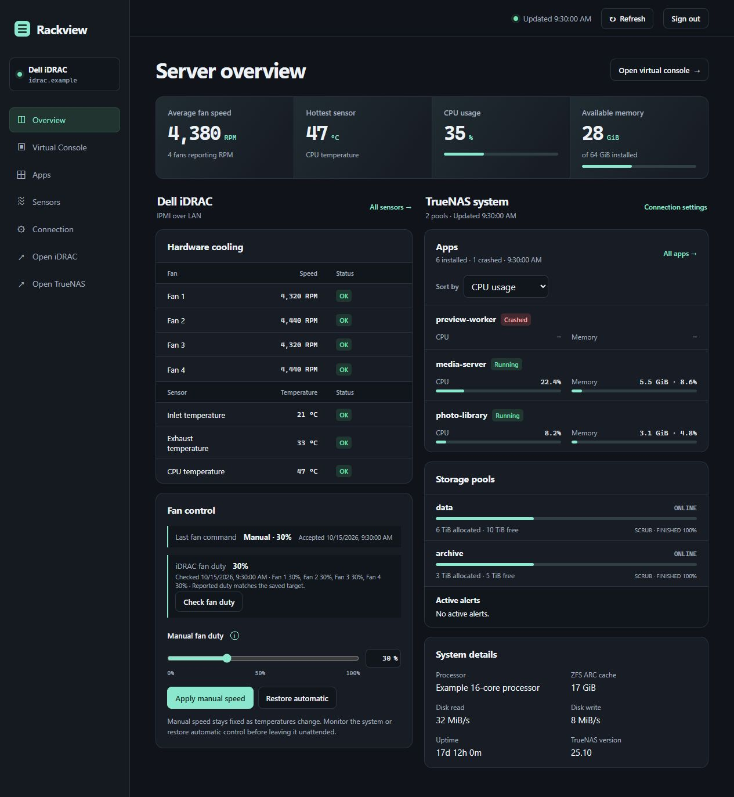
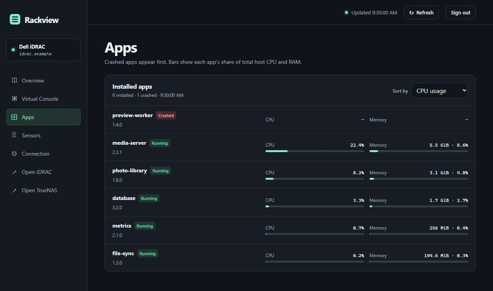
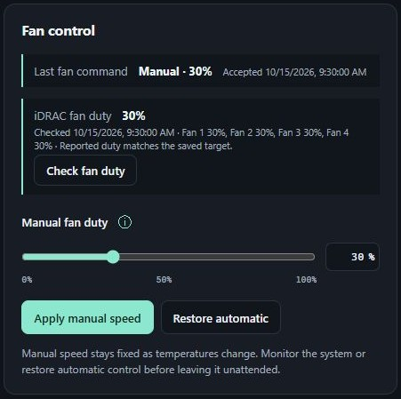
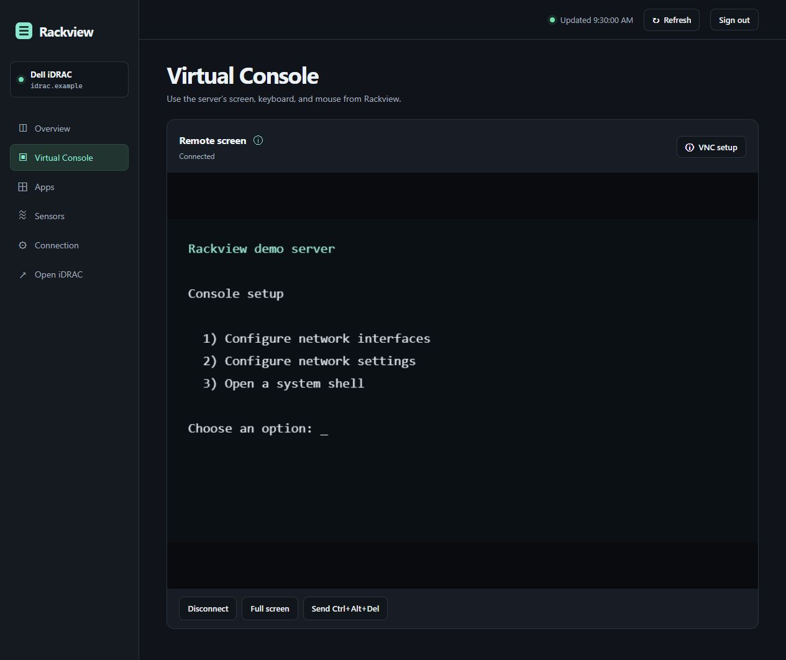
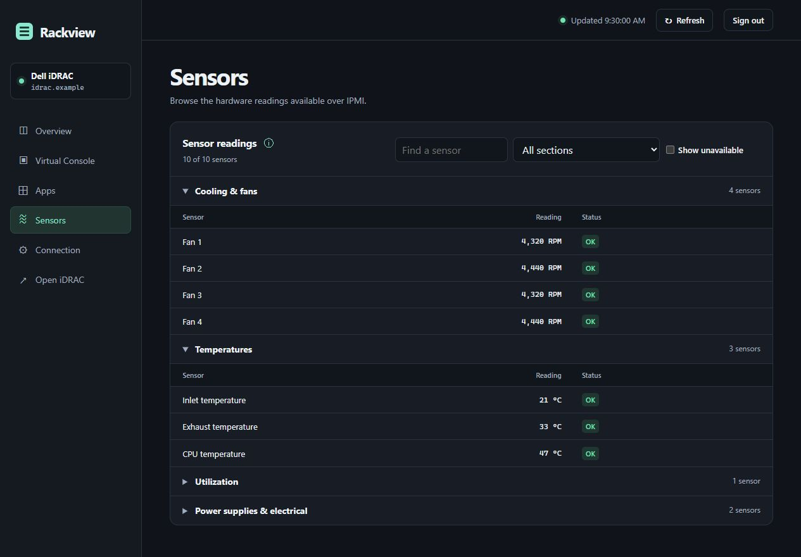

# Rackview

Rackview brings Dell iDRAC cooling, hardware sensors, a VNC console, and read-only TrueNAS monitoring into one dashboard. Overview shows server load, pool capacity and alerts. The Apps tab shows installed TrueNAS applications with crashed apps first and CPU or memory sorting. The layout adapts to phones and desktops. You can configure each integration independently.

## Quick install on TrueNAS or Arcane

**No GitHub login is required.** TrueNAS and Arcane can pull the public Rackview image directly. Open the [raw Compose YAML](https://raw.githubusercontent.com/GalacticaActual75/Rackview/main/compose.truenas.yaml) and copy the entire file.

| Platform | Where to paste the YAML | How to start Rackview |
| --- | --- | --- |
| **TrueNAS 25.10** | Select an Apps pool if this is your first app. Open **Apps → Discover Apps → ⋮ → Install via YAML**, name the app `rackview`, and paste the YAML. | Set your dashboard password, then click **Save**. [TrueNAS guide](https://apps.truenas.com/managing-apps/installing-custom-apps/) |
| **Arcane** | Open **Projects → Create Project**, select your Docker host, name the project `rackview`, and paste the YAML into the Compose editor. | Set your dashboard password, click **Create Project**, then **Up**. [Arcane guide](https://getarcane.app/docs/docker/projects) |

Set `DASHBOARD_PASSWORD` in the pasted YAML to a unique password. The default dashboard username is `admin`, and you can change it with `DASHBOARD_USER`. Write a literal dollar sign as `$$` in Compose. If port `8080` is occupied, change the first port in `"8080:8080"` to a free host port.

Open `http://<server-address>:8080` on your management network (or use your chosen host port), sign in with your Rackview credentials, and follow **Set up Rackview**. Use an HTTPS reverse proxy with WebSocket forwarding when accessing Rackview across an untrusted network.

**Storage and updates.** Rackview writes its iDRAC login, TrueNAS API key, and optionally its VNC password under `/var/lib/rackview`. Protect the volume and its backups as credentials. To use a TrueNAS dataset, replace the `rackview-data` source in the service volume mapping with its absolute host path and give UID/GID `1000:1000` access. For example, the dataset `tank/apps/rackview` uses the mapping `"/mnt/tank/apps/rackview:/var/lib/rackview"`. For Arcane Git Sync, set only the host path in `RACKVIEW_DATA_SOURCE`. To update, pull the latest image and recreate the service using the same project and volume. To pin a build, replace `:latest` with `:sha-<full-git-commit>`. If migrating an existing installation, point the new service at its existing data mount.

## Screenshots

These screenshots use fictional hosts, apps and sensor readings. The virtual console shows a simulated server screen.

| Server overview | Installed apps |
| --- | --- |
|  |  |

| Fan control | Virtual console | Sensors |
| --- | --- | --- |
|  |  |  |

## Optional source build with Arcane Git Sync

### 1. Connect the repository

For a source build that follows the public repository, open **Git Syncs → Git Repositories** and add the HTTPS clone URL `https://github.com/GalacticaActual75/Rackview.git`. Public HTTPS reads work without GitHub credentials. [Arcane Git Sync documentation](https://getarcane.app/docs/docker/git-sync)

Create a **Pull** sync for the Docker host. Choose branch `main` and Compose file `compose.yaml`. Enable **Sync Files** so Arcane copies the `app/` build context, and leave **Redeploy After Sync** off while you configure the deployment. Run the first sync to create the project.

### 2. Set the storage path and dashboard login

The default Rackview username is **admin** and the default password is **admin**. To change them, open the Rackview project in Arcane and go to **Configuration → .env**. Add `DASHBOARD_USER` and `DASHBOARD_PASSWORD` if the lines are missing, enter your values, save, and redeploy. See [`.env.example`](.env.example) for all settings.

| Setting | What to enter |
| --- | --- |
| `RACKVIEW_DATA_SOURCE` | An absolute path to a dedicated directory on the Docker host. Leave it blank to use a Docker-managed volume. |
| `DASHBOARD_USER` | The username you want to use when signing in to Rackview. |
| `DASHBOARD_PASSWORD` | The password you want to use when signing in to Rackview. |
| `RACKVIEW_PORT` | The published host port. Defaults to `8080`. |
| `RACKVIEW_BIND` | An optional host interface address for the published port. |

If you supply a storage path, create the directory before deployment. Rackview runs as UID and GID `1000`, so UID `1000` needs permission to read, write, and traverse that directory. Keep the directory private because it stores the iDRAC connection settings. On TrueNAS, if you created a child ZFS dataset under Arcane's project root after Arcane started, restart the Arcane manager so its mount can include the new dataset.

Keep `.env` and the files in the data directory on the deployment host. Dashboard users sign in with the Rackview login you configure. You will enter the iDRAC login and VNC password separately in Rackview.

### 3. Build, deploy, and sign in

Select **Build & Deploy**, open Rackview using the Docker host address and published port, and enter your dashboard login on the Rackview sign-in page. The browser tab stays signed in across refreshes for up to 12 hours. **Sign out** ends the session. On upgrades from versions that generated credentials, each blank or omitted dashboard login field now defaults to `admin`. To keep a previous login, set both fields in the project's `.env` before redeploying.

To build from a local checkout with Docker Compose, copy `.env.example` to `.env`, set the same fields, and run `docker compose up -d --build` from the repository directory. If you use an HTTPS reverse proxy, forward WebSocket upgrades to the Rackview port for the virtual console.

## Connect to iDRAC

On a new installation, **Set up Rackview** asks what you want to see. Choose hardware readings for iDRAC, system and storage data for TrueNAS, or the remote screen for VNC. The guide opens the connection forms in order and adds the required iDRAC step when you select VNC. Each step can be skipped. Open **Connection → Open setup guide** to run it again.

For hardware readings, enter the iDRAC IP, username, and password. **Test connection** runs `ipmitool mc info` and displays the firmware and protocol versions. **Save connection** stores the credentials in the persistent data directory. An existing password can be reused for the same IP and username by leaving the field blank.

Unavailable readings are hidden by default. Select **Sensors → Show unavailable** to include them in the full sensor list.

The IPMI test requires access over UDP `623` and IPMI over LAN enabled in iDRAC. Successful read access doesn't establish permission for Dell's raw fan commands. Compatibility with these OEM commands also depends on the server firmware. [IPMItool OEM command reference](https://github.com/ipmitool/ipmitool/issues/30)

Disable any existing TrueNAS fan-control cron job when you hand fan control over to Rackview. A cron job can switch iDRAC back to manual after you restore automatic control. **Last fan command** saves the mode, manual percentage and time acknowledged by iDRAC in the data volume. Restarting Rackview restores that history and the manual target without sending a fan command. Older installs start with an empty history. A controller reset or another tool can change cooling after the saved command.

**Check fan duty** reads the PWM percentage for each reporting fan on demand. In Rackview, open **Connection → Optional fan duty readback over SSH → Find SSH host key**. Compare the displayed fingerprint with a trusted SSH client or administrator, select **Trust and save host key**. You can also paste a previously verified host public key. On a computer that already trusts iDRAC, `ssh-keygen -F <iDRAC-IP> -l` shows saved fingerprints. On iDRAC8, enable SSH under **Overview → iDRAC Settings → Network → Services**. Rackview uses port 22, verifies the saved host key and runs the read-only `racadm getsensorinfo` command with the saved iDRAC credentials. Firmware support varies. Overview checks automatically when first opened, timestamps the sample and compares reported PWM readings with the saved manual target. RPM readings remain available over IPMI. [Dell iDRAC8 sensor command and PWM column](https://www.dell.com/support/manuals/en-us/poweredge-m830/idrac8_2.70.70.70_racadm/getsensorinfo?guid=guid-2afd2f94-d004-44c9-9c48-92add6d45e0a&lang=en-us)

## TrueNAS read-only monitoring

Rackview supports the TrueNAS 25.10 JSON-RPC WebSocket API. **Overview** shows CPU usage and available memory alongside fan speed and temperature. Under **TrueNAS system**, each storage pool shows its health and allocated and free space. **System details** includes ZFS ARC size, disk read/write throughput, per-interface network traffic, and uptime. Rackview samples the reporting service when refreshing its 30-second snapshot. Pool health, allocated and free capacity, scrub or resilver progress, and active alerts remain available when reporting is unavailable.

1. In TrueNAS, create a dedicated local user with the **Read-Only Administrator** privilege and web shell disabled. The key inherits that user's permissions. [TrueNAS roles](https://api.truenas.com/v25.10/rbac.html)
2. In **User API Keys**, add a key for that user and copy it. [TrueNAS API key guide](https://www.truenas.com/docs/scale/toptoolbar/managingapikeys/)
3. Open Rackview over HTTPS when entering credentials. Go to **Connection → TrueNAS read-only API**. Enter the HTTPS address that serves the TrueNAS web interface, including its port, the account name, and the key. For a private or self-signed certificate, enter its SHA-256 fingerprint after verifying it against the certificate configured on TrueNAS. Rackview checks the TLS peer before sending the key.
4. If you normally browse the TrueNAS web interface over HTTP, you can keep doing so. To find the separate HTTPS listener, run `midclt call system.general.config | jq .ui_httpsport` in the TrueNAS shell. Enter that HTTPS port in Rackview. TrueNAS can revoke a key presented over insecure transport. [TrueNAS API authentication](https://www.truenas.com/docs/scale/25.10/api/)
5. Select **Test TrueNAS connection**, then **Save TrueNAS connection**. Both actions verify account permissions and read the pool and alert lists. The saved key lives in the private data mount. Return to **Overview** to see the readings or select **Open TrueNAS** in the sidebar to open the configured web interface in a new tab.

The **Apps** card on Overview shows the first three installed TrueNAS apps in the selected order. Open **Apps** for the full inventory, versions and available updates. Both views put crashed apps first, then sort by highest CPU or memory usage. The CPU bars use total host CPU capacity. Memory shows bytes and the percentage of total host RAM reported by TrueNAS. When host RAM capacity is unavailable, Rackview shows the measured bytes alone. The read-only connection uses `app.query` and one `app.stats` sample per refresh. If usage is unavailable, the inventory still shows app states.

## Embedded Virtual Console

Rackview remembers successful console connections for each iDRAC in its persistent data directory. Select **Remember VNC password on this Rackview server** to start the console automatically the next time you open **Virtual Console**. Opening the tab uses the selected profile with a saved password, or the most recent profile with one. If only the port, TLS setting, and fingerprint were saved, enter the VNC password and select **Connect to console**. **Disconnect** ends the session. **Forget saved connection** removes the selected profile and its saved password.

Open **Virtual Console** and select **VNC setup** for Dell's first-time setup paths and version-specific guides. On iDRAC8, the VNC feature requires an Enterprise license. Rackview uses the saved iDRAC IP and the VNC port and password you enter. The usual port is TCP `5901`, and the VNC password is separate from the iDRAC login password. Dell allows a single active VNC session. [Dell iDRAC8 VNC guide](https://www.dell.com/support/manuals/en-us/idrac7-8-lifecycle-controller-v2.30.30.30/idrac8_2.30.30.30_ug/using-vnc-client-to-manage-remote-server?guid=guid-bf36a9fe-9ec5-4f2b-91cd-3a428bb8eb26&lang=en-us)

Match the iDRAC VNC server's TLS setting. For a self-signed certificate, provide the verified SHA-256 fingerprint of the certificate served on the VNC port. From a trusted management network, set `IDRAC_ADDRESS` to your controller's address and run `openssl s_client -connect "${IDRAC_ADDRESS}:5901" -showcerts </dev/null | openssl x509 -noout -fingerprint -sha256`. Rackview verifies a provided fingerprint before forwarding console traffic. The embedded VNC session covers keyboard, video, and mouse. Dell manages virtual media through its native console.

If you see **VNC connected. No video received yet**, the VNC handshake completed and Rackview is still waiting for an image. Check whether the native iDRAC console can see the server's video after closing the Rackview session. Rackview omits TightPNG during VNC negotiation to avoid a known iDRAC8 compatibility issue. [noVNC issue #712](https://github.com/novnc/noVNC/issues/712)
